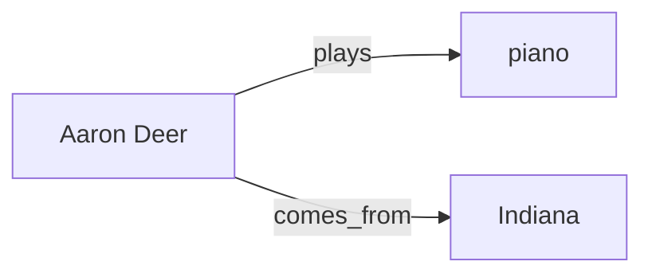

# WebNLG learning with Qwen and Cheetah: practical guide

MiniPhi can teach a small local model to extract facts into Cheetah, then answer a
newly worded question from that saved graph. Here, **learning changes the database,
not the model's weights**. This guide explains the process with selected real
examples. [The complete twenty-example transcript](webnlg_learning.md) contains
every prompt, response, write and failed attempt; the
[JSON audit](benchmarks/webnlg-learning-study-2026-10-26.json) preserves exact wire
requests.

The recorded model was `qwen3-4b-thinking-2507-mlx`, served by LM Studio at
`http://127.0.0.1:1234`, with an 8192-token loaded context. Sources came from the
local English WebNLG training export in `thirds/cheetah/studies/datasets/web_nlg`.
Only human-written target sentences were taught. Gold RDF and answer aliases were
kept outside model prompts for evaluation.

## What happened in the twenty-example study

Twenty concepts span all sixteen dataset categories and contain thirty requested
answer facets. All questions were asked before teaching. MiniPhi then taught all
sources, restarted Cheetah, asked the original questions, and asked different
wordings with fresh model histories. An explicit repair pass preserved the first
run's failures and retested the same rephrased questions.

| Measurement | Recorded result |
| --- | --- |
| Closed-book prior answers matching the selected sources | 1/30 facets |
| Accepted graph answers before teaching | 0/30 |
| Original questions after teaching and restart | 24/30; 14/20 complete examples |
| Different question wording | 17/30; 9/20 complete examples |
| Same rephrased cohort after runtime/source repair | 26/30; 16/20 complete examples |
| Audit size | 386 model calls, including retries; 900 total exchanges |

The first pass wrote 29 claims; the repair pass added 9 edges. Newness means that
an exact subject/relation/object edge was absent. Different predicate spellings or
qualified names can create overlapping edges, so these counts are not distinct
real-world fact counts. Delays between teaching and the first retest were measured
at 67.7–310.8 seconds, with a server restart; this was not a multi-day study.

The score measures **source-answer coverage**, using predeclared aliases and
counting only answers whose graph citations MiniPhi accepted. It is not RDF F1,
semantic entailment, calibrated confidence or general factual accuracy. The 1/30
prior score measures answers elicited by that prompt; it cannot prove that the
model's weights lack the other facts.

## A few different concepts and their outcomes

These are selected results from the same recorded cohort, not additional runs.
The last column is the rephrased retest after the explicit repair pass.

| Concept | What the source taught | Later result |
| --- | --- | --- |
| Music: Aaron Deer | Plays piano; comes from Indiana | Both retrieved |
| Aviation: Abilene Regional Airport | Runway length 2194.0 | `2194.0` retrieved |
| Astronomy: 15788 1993 SB | Discovered by Alan Fitzsimmons | Discoverer retrieved |
| Demography: Antioch California | Population 102372 | `102372` retrieved after anchor repair |
| Literature: 1634: The Baltic War | Author David Weber | Author retrieved |
| Economics: Iraq | Currency Iraqi dinar; official language Arabic | Both retrieved |
| Botany: Almond | Family Rosaceae; order Rosales | Family retrieved; order declined |
| Shipbuilding: A-Rosa Luna | Builder Neptun Werft; MTU Friedrichshafen engine | Engine retrieved; builder answered incorrectly |

Each source is a historical dataset claim. These results do not verify current
population figures, political membership or other changeable real-world facts.

## Worked example: unknown music facts become retrievable memory

### 1. Decompose the question and probe the gap

The original question was:

> What instrument does Aaron Deer play, and where does Aaron Deer come from?

The model split this into two concepts. A condensed view of the recorded
assessment and MiniPhi's empty-graph probes is:

```json
{
  "concepts": [
    {
      "entity": "Aaron Deer",
      "aspect": "instrument",
      "question": "What instrument does Aaron Deer play?",
      "prior_answer": "",
      "self_confidence": 0,
      "memory_gap": true
    },
    {
      "entity": "Aaron Deer",
      "aspect": "origin",
      "question": "Where does Aaron Deer come from?",
      "prior_answer": "",
      "self_confidence": 0,
      "memory_gap": true
    }
  ],
  "needs_learning": true
}
```

`memory_gap` and `needs_learning` are MiniPhi's conclusions, not model permissions.
A high-confidence prior answer would still leave a gap if no accepted graph
answer existed. Unanswered atomic questions are saved as open questions. Prior
answers are never used as facts or fed into graph retrieval as evidence.

### 2. Teach source sentences and save checked claims

Training entries 314 and 316 supplied:

> Aaron Deer plays the piano.
> Aaron Deer comes from Indiana.

The recorded extraction yielded these two source-backed claims:

```json
{
  "facts": [
    {
      "subject": "Aaron Deer",
      "relation": "plays",
      "object": "piano",
      "quote": "Aaron Deer plays the piano."
    },
    {
      "subject": "Aaron Deer",
      "relation": "comes_from",
      "object": "Indiana",
      "quote": "Aaron Deer comes from Indiana."
    }
  ],
  "needs_more_context": false,
  "missing_snippets": [],
  "stop_reason": "completed"
}
```

MiniPhi checked the quoted source, both endpoints and relation wording, probed for
existing edges, then stored the new claims with verbatim episode provenance.
Names are case/whitespace-normalized SHA-256 identities under `knowledge:`.
Punctuation and accents remain significant. Cheetah's upstream Node binder builds
every command; MiniPhi does not construct protocol strings by hand.

The resulting relationships are simple:



### 3. Restart, change the question and retrieve

The later request was:

> Identify an instrument played by Aaron Deer and the place Aaron Deer comes from.

The teaching transcript was absent from the fresh prompt history. The model had
to ask Cheetah for graph evidence. A condensed view of the recorded results is:

```json
{
  "results": [
    {
      "aspect": "instrument played by",
      "answer": "piano",
      "grounded": true,
      "evidence_ids": ["e2"],
      "self_confidence": 1
    },
    {
      "aspect": "place comes from",
      "answer": "Indiana",
      "grounded": true,
      "evidence_ids": ["e1"],
      "self_confidence": 0.95
    }
  ]
}
```

Evidence ids are local to each reasoning call. The cited quotes, not confidence
numbers, allowed these answers. Closed-book diagnostics could still report no
prior knowledge after teaching, because model weights had not changed.

## Current prompts predefine the response JSON

The large recorded study already sent an exact JSON Schema and
`response_format=json_schema`. It **predates the concrete response templates**
added afterward. A schema defines legal output; a template also shows the small
model exactly where to put each value.

Current runtime prompts carry `schema_id`, the complete `response_schema`,
`response_instructions` and context-specific `response_templates`. This is an
excerpt of the lookup template for a focused question, not an old model response:

```json
{
  "schema_id": "cheetah-focused-query",
  "response_templates": [
    {
      "when": "Read graph evidence; an answer is not permitted yet",
      "response": {
        "lookups": [{"entity": "focus", "relation": "", "direction": "out"}],
        "needs_more_context": true,
        "missing_snippets": [],
        "stop_reason": "completed"
      }
    }
  ]
}
```

`focus` resolves to the exact current entity. An empty relation discovers its
stored relations. An incoming query is available when the requested fact runs in
the reverse direction, such as “who built this ship?”. After evidence arrives,
the prompt shows separate shapes for requesting another endpoint, answering with
citations, or declining. It does not prefill a guessed answer.

Repair contracts also narrow the actual schema: the required next lookup's entity,
relation and direction become enum values copied from observed, unqueried
context. The same narrowed schema goes into the prompt, API request and response
validator. If evidence is already complete but a model cites only the final hop,
one answer-or-decline template shows the full observed citation path. The model
must re-cite it; MiniPhi never silently accepts uncited edges.

| Phase | Predefined response structure |
| --- | --- |
| Knowledge assessment | One/two bounded concept objects, each with entity, aspect, atomic question, prior answer, confidence and uncertainty basis |
| Source extraction | Up to four illustrative claim slots matching the source's sentence count; explicit rules for additional claims or an allowed empty array |
| First lookup or retrieval repair | Nonempty lookup items; no final-answer fields |
| Evidence reasoning | Distinct lookup-more, cited-answer and decline templates; confidence/rationale fields when requested |
| Agent context-reference selection | Selected candidate ids or an explicit no-relevant-candidates response |

Templates are checked against their active schema before dispatch. `<...>` marks
values the model must fill from context; numeric examples are illustrative and
must not be treated as measured confidence. Templates never become deterministic
answers or fallback facts. The same prompt-size gate still counts the entire
contract against the loaded context window.

Source coverage is checked too: if accepted claims leave a source sentence absent
from their quotes, one repair receives `uncovered_source_sentences`. Already
accepted claims survive. This catches some omissions; it does not prove that all
claims inside a single quoted sentence were extracted.

The reusable builder is `PromptSchemaRegistry.buildResponseContract()` in
`src/libs/prompt-schema-registry.js`. Graph phase choices live in
`src/libs/cheetah-prompt-contract.js`; `ContextReferenceComposer` uses the same
builder for the coding agent's sentence selection. Other features can supply
their own phase templates without duplicating schema validation. JSON-envelope
schema retries keep those templates and add a structured `response_correction`.
An invalid JSON response gets one schema repair on the same transport; it is not
a reason to switch from REST to WebSocket. Rejected response text remains audited.

<!-- response-structure-results:start -->
## Measured response-template comparison

A separate controlled run used 4 frozen concepts (music, population, shipbuilding and botany), 2 repeats per arm, both question wordings and fresh graphs restarted after teaching. Arm order alternated between repeats. The baseline kept the same runtime and exact JSON schemas but omitted only the new response templates/instructions. Gold answers stayed outside prompts.

| Measurement | Schema only | With response templates |
| --- | --- | --- |
| Source-answer facets recovered | 24/28 | 22/28 |
| Complete compound/simple questions | 12/16 | 10/16 |
| Schema-valid model responses | 86/86 | 90/90 |
| Atomic questions needing deterministic repair | 3 | 2 |
| Identical normalized answer lists across repeats | 6/8 | 4/8 |
| Untaught controls declined | 2/2 | 2/2 |

Exact answer-list stability is separate from correctness: consistently wrong answers or declines can be stable, qualified endpoint names can differ while referring to the same source facet, and duplicate answers are retained. This small repeated sample does not establish a general accuracy or reliability gain. Schema-valid JSON was already enforced in the baseline.

This comparison records the **first one-item extraction-template prototype**. It lost source statements in shipbuilding and botany, so templates alone were worse on this sample. The runtime was then changed to show source-aware extraction slots and request one bounded repair for source sentences missing from accepted quotes. The original comparison is retained above.

The subsequent single-arm check repeated `A-Rosa Luna` and `Almond` 2 times, using both question wordings after restart. It wrote **8 source-backed edges**, invoked 2 missing-sentence repairs, and recovered **10/16 source-answer facets** (2/8 complete questions). Model responses were schema-valid in 52/52 calls; 2/2 untaught controls had no accepted answer. This verifies the revised path on those examples; a single-arm follow-up cannot establish superiority over the baseline.

A final two-hop acceptance run then passed learning, a two-edge `Denmark` answer, untaught-control refusal and the same answer after restart. It uses the final context-narrowed lookup schemas and complete-path citation templates. The audit retains 2 preceding failed acceptance attempts alongside the passing prompt/response records. The intermediate failures exposed stale lookup requests and final-hop-only citations; that regression is closed, while the broader semantic-role problem remains open.

The [complete comparison audit](benchmarks/webnlg-response-structure-2026-10-26.json) preserves runtime hashes, sources, both arms' prompts, raw responses and retrieval traces. These results are separate from the earlier twenty-concept cohort.

Run the comparison protocol against the current runtime with the exact model loaded, running model jobs sequentially (the historical hashes remain in the audit):

```sh
node scripts/benchmark-webnlg-response-structure.js --repeats 2 --output .miniphi/cheetah/response-structure/new-run
node scripts/benchmark-webnlg-response-structure.js --case-ids 11-shipbuilding,17-botany --arms templates --repeats 2 --output .miniphi/cheetah/response-structure/new-followup
node scripts/render-webnlg-response-structure.js --state .miniphi/cheetah/response-structure/new-run/report.json --followup-state .miniphi/cheetah/response-structure/new-followup/report.json
```
<!-- response-structure-results:end -->

## What remains unreliable

The twenty-example transcript deliberately retains the four missed facets:

| Failure | What it shows |
| --- | --- |
| London as a city, England as a country | A `located_in` edge does not explicitly type an endpoint; the conservative role check declined both |
| A-Rosa Luna builder | The model cited `powered_by` and returned the engine for the builder; connected-path validation incorrectly accepted the wrong role |
| Almond taxonomic order | Rosales evidence existed, but the model still declined after a corrupted subquestion was repaired |

`grounded: true` currently establishes an observed endpoint and accepted citation
path, not full semantic correctness. `needsLearning` can consequently miss a
wrong-role answer. Better response structure cannot itself prove that a relation
answers the requested aspect. Confidence is also uncalibrated: the wrong builder
answer carried confidence 0.8.

The additional Ajoblanco ingredient → botanical-family query declined. An untaught
institute control also declined, as required. General cross-concept reasoning,
semantic role adjudication, alias merging, contradictions and automatic use of
this graph by the coding agent remain open. The old `ask` and `knowledge_lookup`
paths use an earlier memory shape; use `graph-ask` for this experiment.

## Try it locally

Initialize/build Cheetah using its [handbook](../thirds/cheetah/AGENTS.md), start the
server, and load the exact model:

```sh
node src/index.js models --load qwen3-4b-thinking-2507-mlx --context-length 8192
node src/index.js lmstudio-health --timeout 10
node src/index.js cheetah-learn webnlg --offset 314 --limit 1 --checkpoint .miniphi/cheetah/webnlg/music-instrument.json
node src/index.js cheetah-learn webnlg --offset 316 --limit 1 --checkpoint .miniphi/cheetah/webnlg/music-origin.json
node src/index.js cheetah-learn graph-ask "What instrument does Aaron Deer play and where does Aaron Deer come from?" --decompose --max-rounds 6 --json
```

The commands teach the two music entries with separate checkpoints. The default
database for both actions is `miniphi_webnlg`; the twenty-concept study used
`webnlg_study`. Neither command resets a database. A general `webnlg --limit 20`
run starts at the first rows and does not include Aaron Deer.

To reopen this machine's recorded twenty-concept graph, start Cheetah in one
terminal, then use `--cheetah-database webnlg_study` in another:

```sh
CHEETAH_HEADLESS=1 CHEETAH_LISTEN_ADDR=127.0.0.1:4455 \
  CHEETAH_DATA_DIR="$PWD/.miniphi/cheetah/webnlg-study/cohort-20/data" \
  thirds/cheetah/cheetah-server
```

Saved database files are local and are not included in Git. `--json` exposes the
assessment, per-concept graph answer, citations, confidence and stop reason.
`--max-rounds` accepts 1–8 and defaults to four. Detailed flags, checkpoint identity,
budgets and retry bounds are in [AGENTS.md](../AGENTS.md#webnlg-structured-knowledge-experiment-2026-10-26).

For a separate two-hop demonstration, teach entries 3 and 278 with separate
checkpoints: Aarhus Airport → Tirstrup → Denmark. The live acceptance test passed
extraction, a two-edge cited answer, untaught-control decline and retrieval after
restart in 30.5 seconds. The earlier first-twenty-row benchmark matched only 5/20
gold endpoint pairs; that metric differs from the selected-concept answer coverage
above. Those earlier measurements have their own
[audit](benchmarks/webnlg-qwen3-4b-2026-10-26.json).

```sh
node --test unit-tests-js/structured-response-contract.test.js unit-tests-js/cheetah-graph-learning.test.js unit-tests-js/context-reference-composer.test.js
MINIPHI_LMSTUDIO_INTEGRATION=1 MINIPHI_CHEETAH_INTEGRATION=1 \
  LMSTUDIO_REST_URL=http://127.0.0.1:1234 \
  MINIPHI_LIVE_MODEL=qwen3-4b-thinking-2507-mlx \
  node --test unit-tests-js/cheetah-webnlg.live.test.js
```

Run real-model checks sequentially. Prompts, raw responses/reasoning, tool calls,
tool definitions and validation outcomes persist under `.miniphi/`; keep failed
attempts when interpreting a result.
